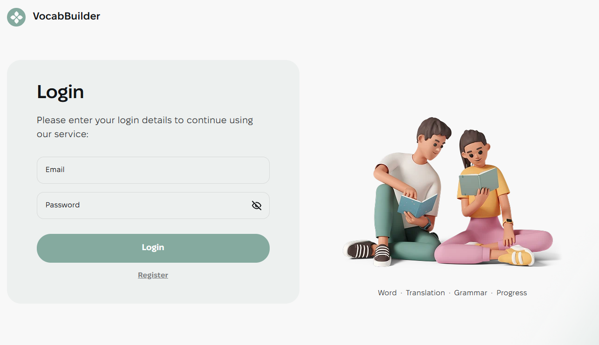
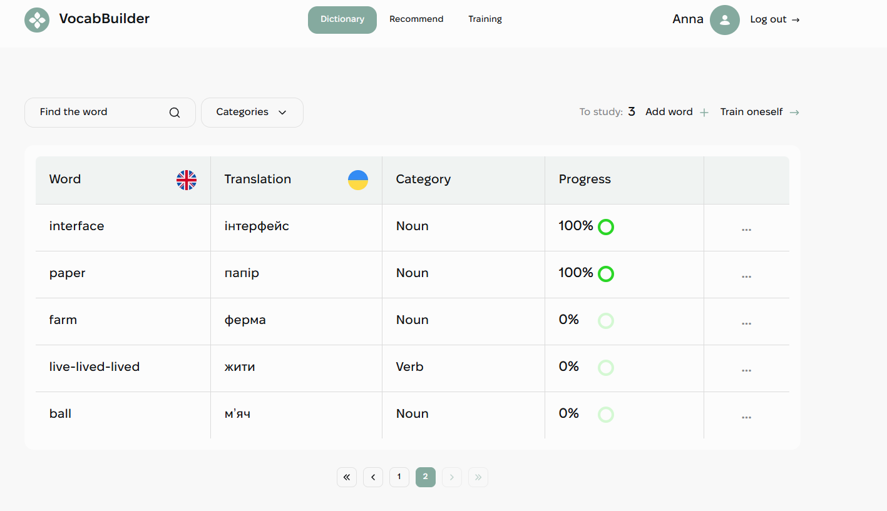
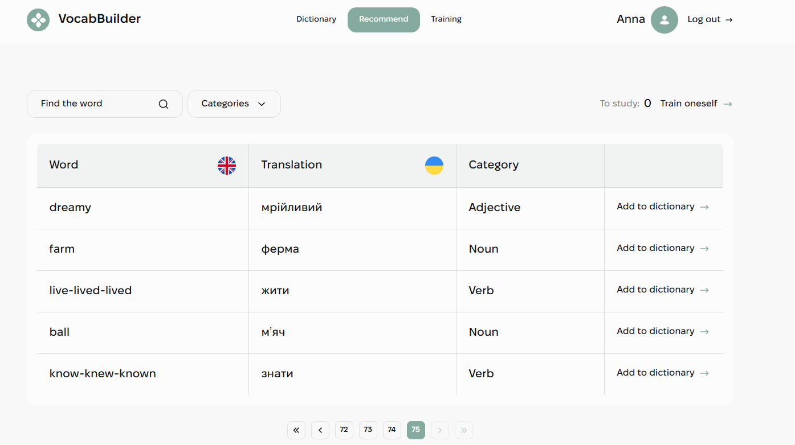
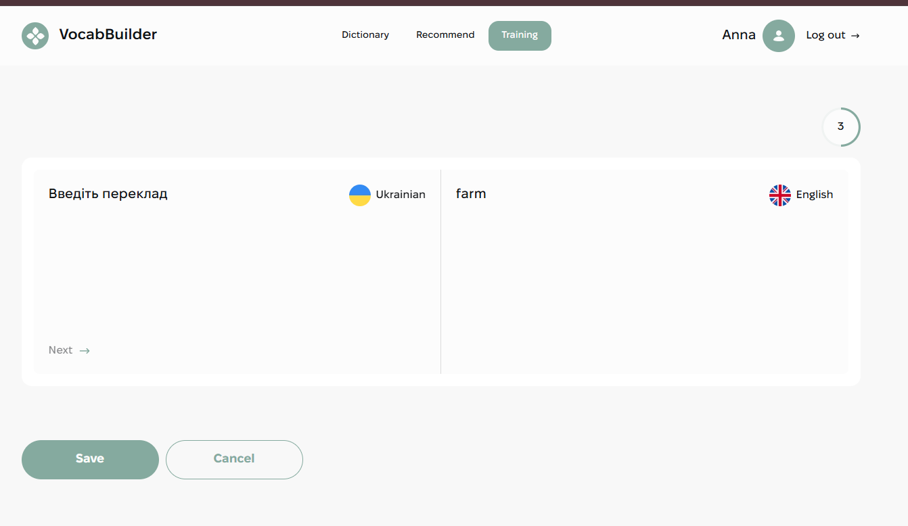
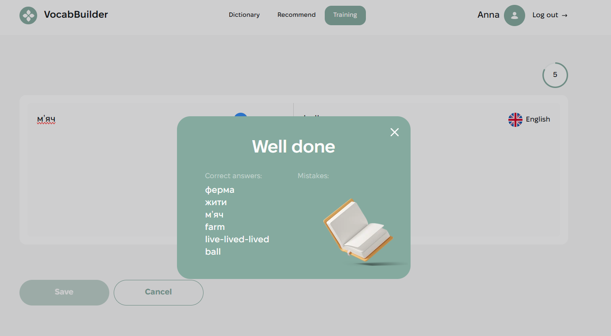

<p align="right">🇬🇧 English | 🇺🇦 <a href="README.uk.md">Українська</a></p>

# VocabBuilder


A web application for learning English words. Users keep their own dictionary, add words from a shared list of recommendations and practice them in training, where the progress of every word is tracked.

🚀 **Live demo:** [vocab-builder](https://YOUR-LINK.vercel.app)
🎨 **Design:** [Figma mockup](https://www.figma.com/design/XRhVBdCX1wPyzCRA567kud/VocabBuilder?node-id=0-1)

## Pages

- **Register / Login**: forms with validation; the session is kept after a page refresh.

  

- **Dictionary**: the user's own words with search, category filter, verb type, pagination and learning progress. Words can be added, edited and deleted.

  

- **Recommend**: words from the shared base that can be added to the dictionary in one click.

  

- **Training**: translate your words (en → ua and ua → en) with a progress indicator. After saving, a modal shows correct answers and mistakes.

  

  

## Features

- Registration, login and logout with a JWT token; the token is kept with redux-persist and the user is refreshed on app start
- Private and restricted routes, lazy-loaded pages
- Search with debounce, category select, Regular / Irregular filter for verbs
- Server-side pagination (7 words per page)
- Words table built with TanStack Table, circular progress with MUI
- Add / edit word forms with react-hook-form + yup (English and Ukrainian validation)
- Actions popover (edit / delete) with MUI Popover
- Training: answers are sent to the backend, which updates the progress of each word
- Modal windows close with the close button, a click on the backdrop or the Esc key
- Notifications with react-hot-toast
- Responsive layout: mobile (320px+), tablet (768px+), desktop (1440px+) with a burger menu; retina images and an SVG sprite

## Tech stack

React 19, TypeScript, Vite, Redux Toolkit, redux-persist, React Router 7, Axios, react-hook-form, yup, MUI, TanStack Table, react-hot-toast, CSS Modules.

## Technical specification

1. Authentication against the backend: register, login, current user, logout. The token is stored and sent in the `Authorization` header.
2. Register, login, add and edit forms use react-hook-form and yup.
3. **Dictionary**: dashboard (filters, "To study" counter, Add word, Train oneself), words table with progress and actions, pagination.
4. **Recommend**: the same dashboard and table without progress; a word is added with "Add to dictionary".
5. **Training**: tasks from `/words/tasks`; Next saves the answer and shows the next task; Save sends all answers to `/words/answers` and opens the results modal. If there are no tasks, the user is offered to add a word.
6. ProgressBar is one reusable component for the table and for training.

## Backend

API: `https://vocab-builder-backend.p.goit.global/api` ([Swagger docs](https://vocab-builder-backend.p.goit.global/api-docs))

## Getting started

```bash
git clone https://github.com/Anna-Ivanchenko/vocab-builder.git
cd vocab-builder
npm install
npm run dev
```

Other commands: `npm run build`, `npm run lint`, `npm run preview`.

## Deploy

The app is a single-page application, so a fallback to `index.html` is needed. On Vercel it is set in `vercel.json`.

## Project structure

```
src/
├── components/   UI components (Header, WordsTable, ProgressBar, Modal, TrainingRoom, ...)
├── hooks/        useDebounce, useMediaQuery, useWords
├── pages/        Login, Register, Dictionary, Recommend, Training
├── redux/        auth, words and training slices, operations, selectors
├── routes/       PrivateRoute, RestrictedRoute
├── services/     axios instance
├── styles/       variables, fonts, base styles
├── types/        TypeScript types
└── utils/        validation, buildWordsQuery, getPageNumbers, matchCase, ...
```

## Author

**Anna Ivanchenko**
[GitHub](https://github.com/Anna-Ivanchenko)
