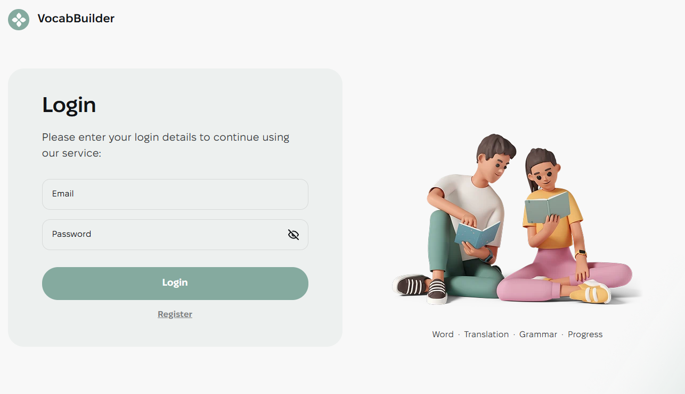
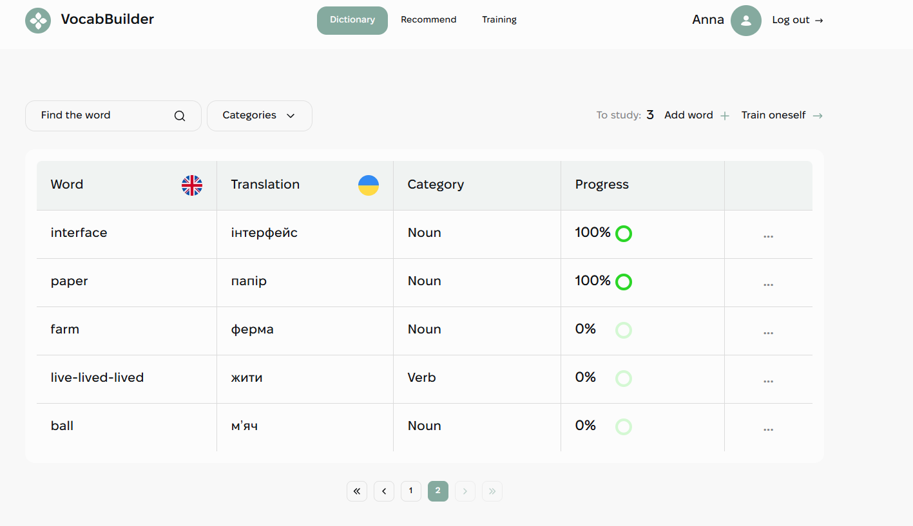
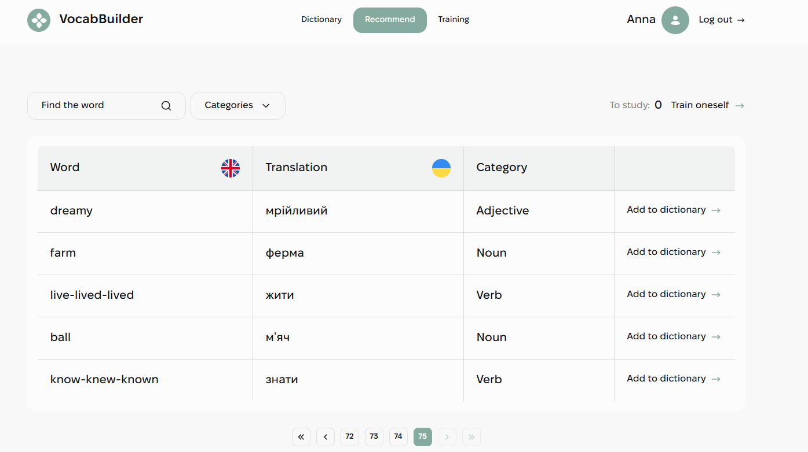
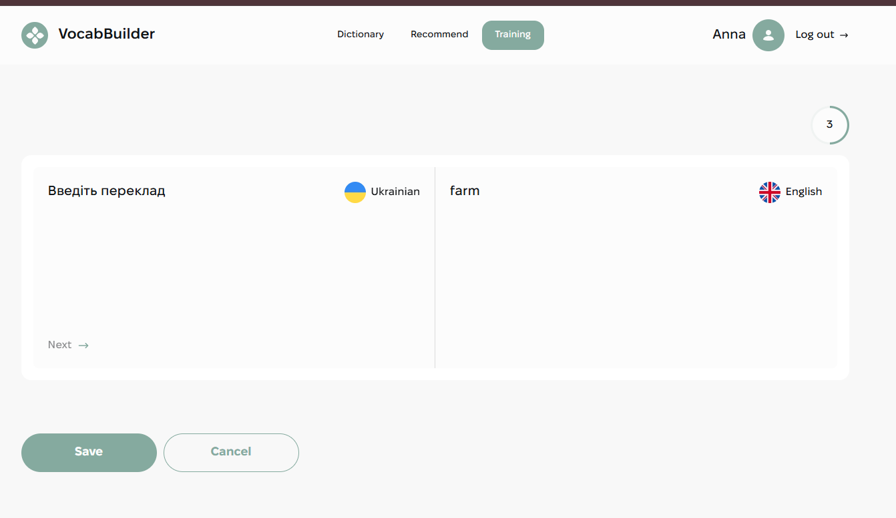
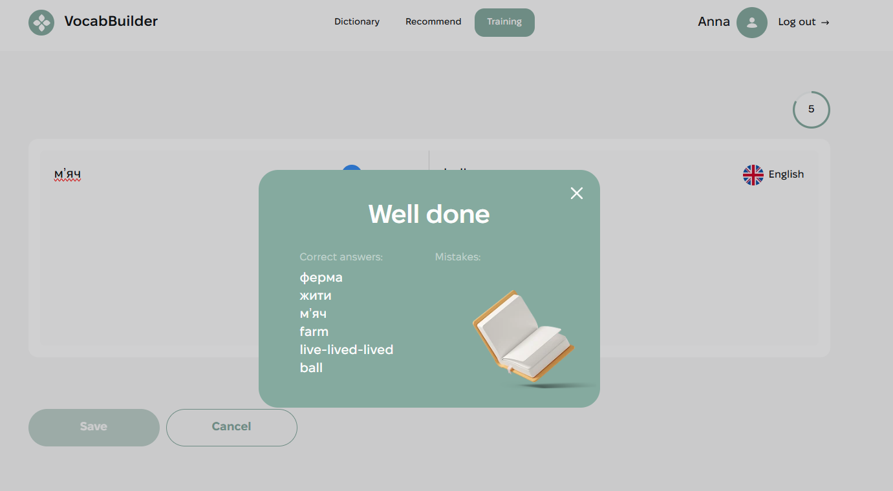

<p align="right"><a href="README.md">🇬🇧 English</a> | 🇺🇦 Українська</p>

# VocabBuilder


Веб-застосунок для вивчення англійських слів. Користувач веде власний словник, додає слова зі спільного списку рекомендацій і тренує їх. Прогрес кожного слова зберігається.

🚀 **Демо:** [vocab-builder](https://vocab-builder-ten-bice.vercel.app)
🎨 **Дизайн:** [макет у Figma](https://www.figma.com/design/XRhVBdCX1wPyzCRA567kud/VocabBuilder?node-id=0-1)

## Сторінки

- **Реєстрація / Логін**: форми з валідацією, сесія зберігається після оновлення сторінки.

  

- **Dictionary**: власні слова користувача з пошуком, фільтром за категорією, типом дієслова, пагінацією і прогресом вивчення. Слова можна додавати, редагувати й видаляти.

  

- **Recommend**: слова зі спільної бази, які можна додати до словника одним кліком.

  

- **Training**: переклад своїх слів (en → ua і ua → en) з індикатором прогресу. Після збереження модальне вікно показує правильні відповіді й помилки.

  

  

## Можливості

- Реєстрація, логін і логаут з JWT-токеном. Токен зберігається через redux-persist, користувач оновлюється під час старту застосунку
- Приватні й обмежені маршрути, ліниве завантаження сторінок
- Пошук з debounce, вибір категорії, фільтр Regular / Irregular для дієслів
- Серверна пагінація (7 слів на сторінку)
- Таблиця слів на TanStack Table, круговий прогрес на MUI
- Форми додавання й редагування на react-hook-form + yup (валідація англійською та українською)
- Меню дій (редагувати / видалити) на MUI Popover
- Тренування: відповіді відправляються на бекенд, який оновлює прогрес кожного слова
- Модальні вікна закриваються кнопкою, кліком по фону або клавішею Esc
- Сповіщення через react-hot-toast
- Адаптивна верстка: мобільна (від 320px), планшет (від 768px), десктоп (від 1440px) з бургер-меню; ретина-зображення й SVG-спрайт

## Стек

React 19, TypeScript, Vite, Redux Toolkit, redux-persist, React Router 7, Axios, react-hook-form, yup, MUI, TanStack Table, react-hot-toast, CSS Modules.

## Технічне завдання

1. Автентифікація через бекенд: реєстрація, логін, поточний користувач, логаут. Токен зберігається й передається в заголовку `Authorization`.
2. Форми реєстрації, логіну, додавання й редагування слова на react-hook-form і yup.
3. **Dictionary**: дашборд (фільтри, лічильник «To study», Add word, Train oneself), таблиця слів з прогресом і діями, пагінація.
4. **Recommend**: той самий дашборд і таблиця без прогресу; слово додається кнопкою «Add to dictionary».
5. **Training**: завдання з `/words/tasks`; Next зберігає відповідь і показує наступне завдання; Save відправляє всі відповіді на `/words/answers` і відкриває вікно з результатами. Якщо завдань немає, користувачу пропонується додати слово.
6. ProgressBar — один універсальний компонент для таблиці й тренування.

## Бекенд

API: `https://vocab-builder-backend.p.goit.global/api` ([документація Swagger](https://vocab-builder-backend.p.goit.global/api-docs))

## Запуск

```bash
git clone https://github.com/Anna-Ivanchenko/vocab-builder.git
cd vocab-builder
npm install
npm run dev
```

Інші команди: `npm run build`, `npm run lint`, `npm run preview`.

## Деплой

Це односторінковий застосунок, тому потрібен fallback на `index.html`. На Vercel він налаштований у `vercel.json`.

## Структура

```
src/
├── components/   UI-компоненти (Header, WordsTable, ProgressBar, Modal, TrainingRoom, ...)
├── hooks/        useDebounce, useMediaQuery, useWords
├── pages/        Login, Register, Dictionary, Recommend, Training
├── redux/        слайси auth, words і training, операції, селектори
├── routes/       PrivateRoute, RestrictedRoute
├── services/     екземпляр axios
├── styles/       змінні, шрифти, базові стилі
├── types/        типи TypeScript
└── utils/        validation, buildWordsQuery, getPageNumbers, matchCase, ...
```

## Автор

**Anna Ivanchenko**
[GitHub](https://github.com/Anna-Ivanchenko)
